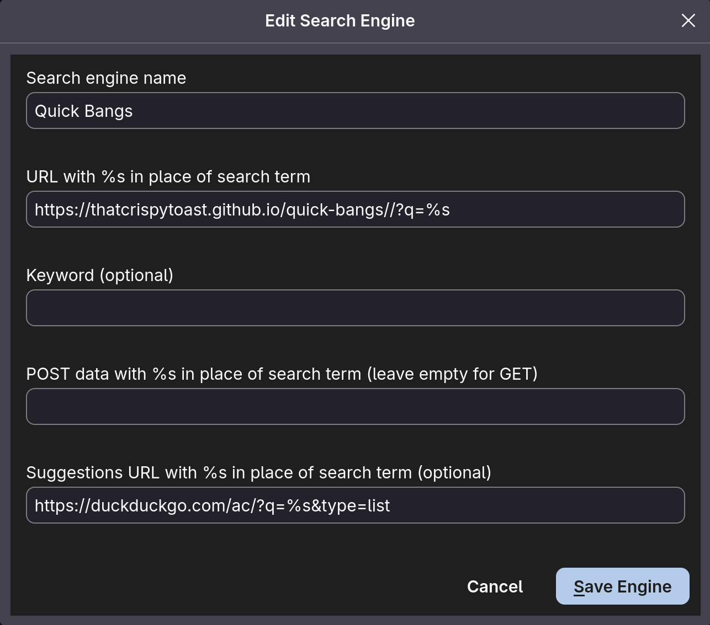
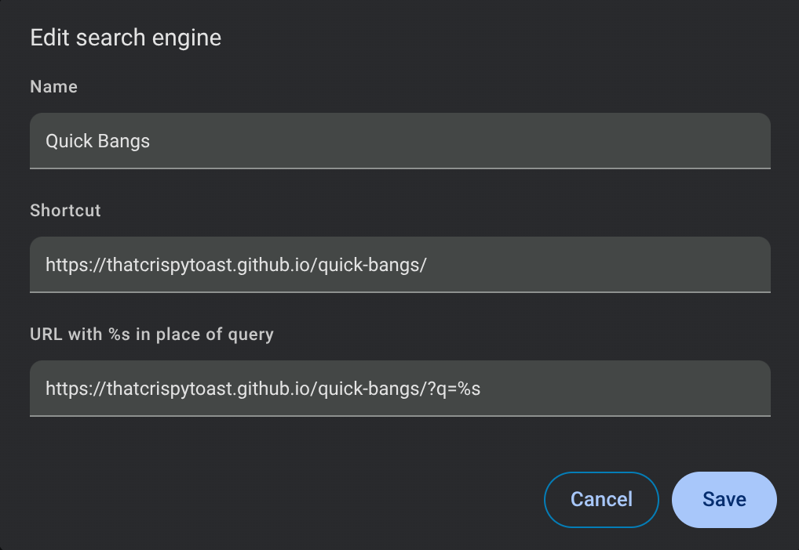

# quick-bangs
A suckless bang implementation with custom bang support.

## Configuration
Edit the JSON in the `<script type="application/json" id="config">` block in `index.html`. Use valid JSON (double quotes, no comments or trailing commas).

- **Default Search Engine**: If no bangs are specified, this engine is used.
- **Quicker Bangs**: Lowercase trigger-to-URL pairs defining custom bangs. These take priority over Kagi's list and bypass database lookups.

### Default engine URL parameter

Add `default=<bang>` to choose a default engine for that URL, without editing the configuration:

```text
https://thatcrispytoast.github.io/quick-bangs/?default=ddg&q=%s
```

This uses DuckDuckGo for ordinary searches. `default=g` uses Google, and custom triggers or Kagi aliases work too. Trigger names are case-insensitive; a leading `!` is optional. The setting applies to the current URL and is not saved.

An explicit bang in the query takes priority: `?default=ddg&q=!yt+cats` searches YouTube. Unknown bangs stay in the search text. An unknown `default` falls back to `defaultUrl` from the configuration.

### Redirects and caching

- Plain searches and custom bangs redirect inline on the first visit, without waiting for the database script or bang list.
- Once the service worker controls the site, it returns redirects directly, without loading a page. External bangs use a single IndexedDB transaction to read the URL and its freshness marker.
- The first external bang downloads Kagi's list. Later searches reuse it for 30 days; stale entries remain usable while the worker refreshes the list in the background. Existing IndexedDB caches are reused.
- Cached searches need no page/script network requests between hourly asset revalidations. Only the page and database script are cached, under fixed, query-free keys scoped to this installation.
- After editing configuration, visit the site without `q`, allow the background update to finish, then search again. This also works for installations under a subdirectory.
- Service workers require HTTPS or localhost. Without one, the page loads the database script only for external bangs; stale refreshes are best-effort. If storage is unavailable, downloaded bangs can still resolve. Download failures fall back to the configured engine.

## Development and verification

There is no build step or runtime dependency. Serve this directory with any static HTTP server. Tests use Node.js 22+ and Chromium, without npm packages:

```sh
node --test tests/*.test.mjs
node tests/benchmark.mjs
```

Set `CHROMIUM` if the browser executable is not named `chromium`. On NixOS, an ephemeral environment is available with `nix-shell -p nodejs chromium`.

The benchmark measures navigation-to-redirect time, simulates a 100 ms external-script request on first visits, and reports 20 warmed external-bang samples plus asset request counts. It uses a small local fixture by default; set `BANGS_FIXTURE=/path/to/bangs.json` to use a full dataset. An optional directory argument benchmarks another checkout using the same harness. Network conditions, browser state, and hardware affect timings.

Measured on Chromium 156 with a local full-list fixture (10,910 entries), compared with commit `8d4926b`:

| Search path | Before | After |
| --- | ---: | ---: |
| Plain search, 100 ms script delay | 116 ms | 15 ms |
| Custom bang, 100 ms script delay | 109 ms | 12 ms |
| First external bang, 100 ms script delay | 141 ms | 149 ms |
| Cached external bang, no worker (median) | 35 ms | 37 ms |
| Cached external bang, worker (median) | 27 ms | 20 ms |
| Page/script requests over 20 warm worker searches | 40 | 0 |

The main gains are on plain/custom searches and worker-controlled searches. First-run external lookups still download and persist the full list; the fallback without a worker has similar latency to the original implementation.

## Installation

### Getting Your URL

#### Self-Hosted
Clone the repo. Deploy however you deploy your static web apps.
#### Public Instance
A public instance of quick-bangs is available at https://thatcrispytoast.github.io/quick-bangs/.

### Adding the Search Engine

**Query URL:** `https://thatcrispytoast.github.io/quick-bangs/?q=%s`

#### Firefox and Firefox Forks (zen, tor, librewolf, floorp, etc.)
Add the engine with the query parameter above to your "Search Shortcuts" list. Replace the base URL if hosting the project locally. Optionally, a suggestion URL of your choice can be added. The example below uses the DuckDuckGo suggestion engine. Set as default by selecting it under the "Default Search Engine" dropdown after adding.



#### Google Chrome and Chromium-Based Browsers (brave, vivaldi, ungoogled-chromium, opera, etc.)
Add the engine with the query parameter above to your "Site Search" list. Replace the base URL if hosting the project locally. Set as default by clicking the three dots to the left of the newly created search shortcut and selecting "Make default" from the menu.



